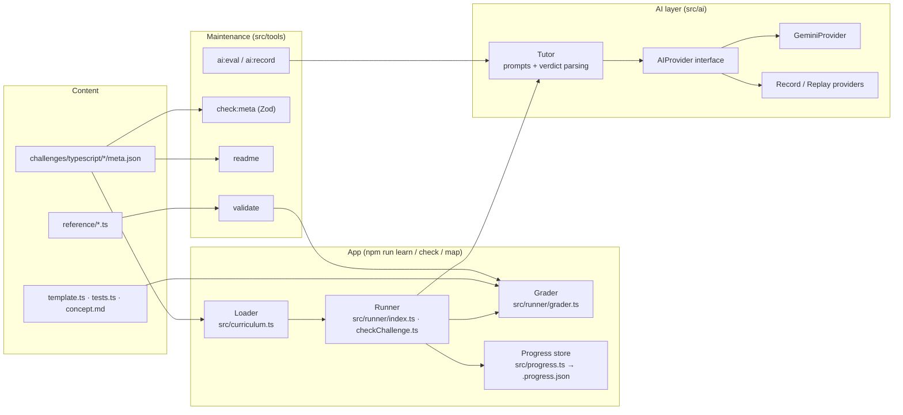

# Architecture

TypeDojo is a terminal app plus a few maintenance tools. Everything runs through ts-node; there is no server.

## Pieces

**Loader** (`src/curriculum.ts`) reads every `meta.json` under `challenges/typescript/` in folder order. It also answers whether a topic is validated or draft. A topic with no `status` is draft.

**Runner** (`src/runner/`) is the interactive UI. It shows concept cards and questions, copies `template.ts` to `solution.ts` the first time a coding challenge is opened, and drives a check: compile, then tests, then the optional AI review.

**Grader** (`src/runner/grader.ts`) has no UI and no side effects. `compileCheck` runs the solution through ts-node with full type checking. `runTests` runs the challenge's `tests.ts`, which imports `./solution` and exits non-zero on any failed check. The interactive check and `npm run validate` both use it.

**Progress store** (`src/progress.ts`) is a JSON file, `.progress.json`, holding results per challenge id, the last challenge seen, and which topics were unlocked at onboarding. `TYPEDOJO_PROGRESS_FILE` points it elsewhere, which the tests use.

**AI layer** (`src/ai/`):
- `AIProvider` is the only thing a model backend implements: `generate(prompt) → text`.
- `GeminiProvider` is the one real backend. Its HTTP call can be injected, so tests check the request without a network call.
- `Tutor` knows what to ask (`evaluate`, `insight`, `ask`), loads the prompts from `src/ai/prompts/`, and parses the PASS/FAIL verdict. The app only ever calls `createTutor()`.
- `RecordingProvider` and `ReplayProvider` save and replay responses keyed by provider, model and exact prompt, so evals run offline and a changed prompt never reuses a stale answer.

## Quality gates

| Gate | What it proves |
|---|---|
| `npm run validate` | For each coding challenge in a validated topic, the reference solution passes `tests.ts` and the untouched template fails it with type checking off. So the tests are neither broken nor vacuous. Each run uses a scratch copy, so the learner's `solution.ts` is never touched. |
| `npm run check:meta` | Every `meta.json`, drafts included, matches the Zod schema in `src/schema.ts`. |
| `npm run readme -- --check` | The README topic table and status counts match the metadata. |
| `npm test` | The loader, grader, progress store, README generator, schema check and AI layer work as described, using fixtures and a fake provider. |
| `npm run ai:eval -- --check` | Every golden-set case passes its runtime tests, so the expected verdicts depend on the AI review alone. |
| `npm run ai:eval` | How often the AI review agrees with the golden set. Needs recordings from `npm run ai:record`; not run in CI. |

## Known limits

- `types-02` asks only for type annotations. Its template already holds the right values, and `let` infers the same types, so no runtime test can tell it apart from a correct answer. `validate` lists it as a documented exception; the compile step and AI review grade it.
- Some async challenges can't observe the construct they teach. For example, `async-06`'s `ping` never rejects, and `async-08`'s `get` resolves at once, so the timeout path never runs. A solution that skips `allSettled` or the timeout still passes the tests. These gaps are what the golden set's bad cases target.
